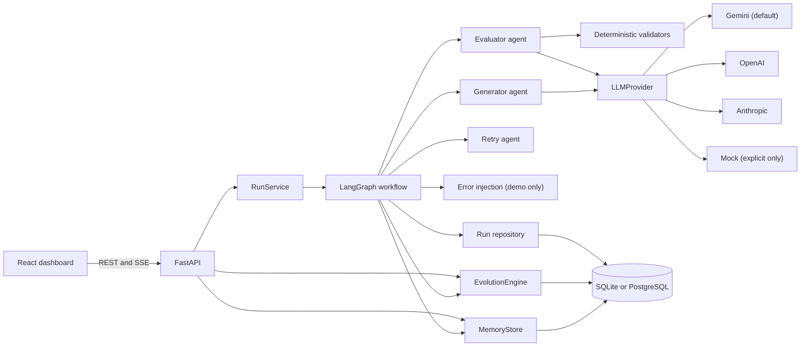
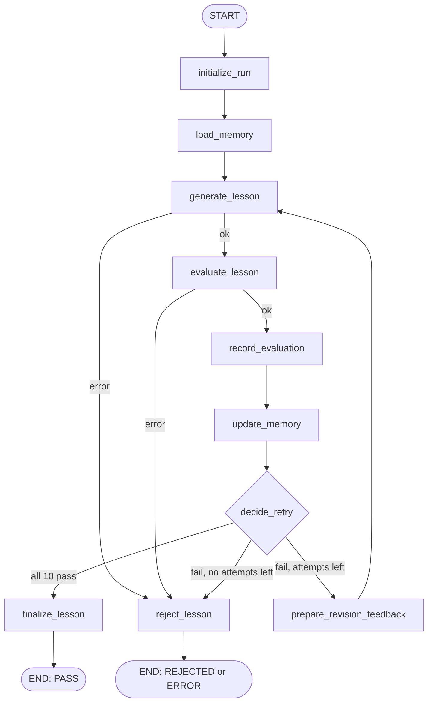
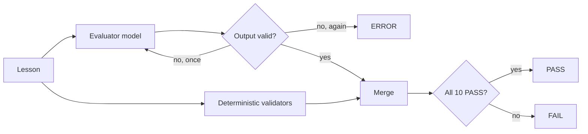
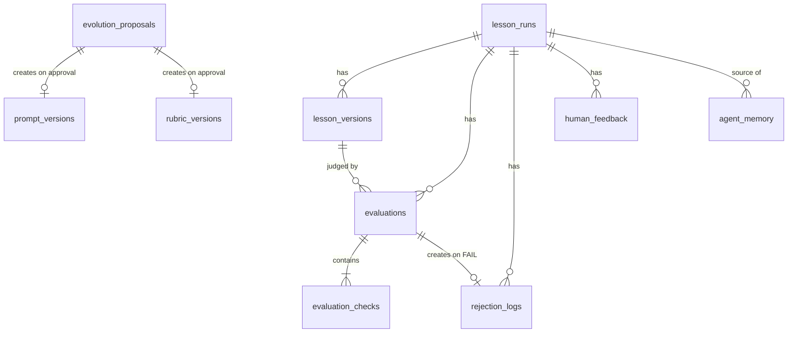

# Architecture

## Components

| Layer | Location | Responsibility |
|---|---|---|
| API | `backend/app/api` | HTTP, validation, rate limits, safe errors |
| Workflow | `backend/app/graph` | State and control flow, with no business rules |
| Agents | `backend/app/agents` | Generator, evaluator, retry agent |
| Providers | `backend/app/llm` | Vendor differences behind one interface |
| Validators | `backend/app/validators` | Rubric rules and deterministic checks |
| Memory | `backend/app/memory` | Learning from history, and proposals |
| Services | `backend/app/services` | Persistence, run handling, error injection |

## Workflow

- **Attempts:** one generation plus up to two retries. Every generated lesson gets exactly one recorded evaluation, whose model call may be retried once if its output is invalid.
- **Versions pinned per run:** a run uses the prompt and rubric versions that were active when it started, even if a proposal is approved during the run.
- **Error routing:** `error_message` sends a run to `reject_lesson`, which ends it as `ERROR` and doesn't publish.

## Evaluation

## Data model

| Table | Holds |
|---|---|
| `lesson_runs` | One row per run: status, attempts, provider, model, prompt and rubric versions, tokens, cost, injection record, memory used |
| `lesson_versions` | Each generated lesson, with hash, changed sections and whether it was injected |
| `evaluations` | One per generated lesson: verdict, usage, deterministic issues |
| `evaluation_checks` | One per criterion: status, evidence, reason, correction, source |
| `rejection_logs` | Each failed attempt: failed checks, feedback, previous and revised lesson |
| `agent_memory` | Failure patterns, correction strategies, human feedback, topic guidance, run summaries |
| `prompt_versions` | Versioned prompts, with at most one active per name |
| `rubric_versions` | Versioned rubric definitions, with at most one active |
| `human_feedback` | Reviewer ratings and comments |
| `evolution_proposals` | Proposed changes, evidence, decisions and the versions they produced |

## Streaming

`POST /api/v1/lessons/generate/stream` sends these Server-Sent Events:

| Event | Data |
|---|---|
| `started` | `run_id`, `maximum_attempts` |
| `stage` | `node`, `event` (`start` or `complete`), `attempt`, and node-specific details such as `failed_criteria` |
| `complete` | The same body as `POST /generate` |
| `error` | A safe `message` |

Request problems (validation, duplicates, injection refusal) return a normal HTTP error before streaming starts.

A run executes on its own thread and doesn't depend on the client. If the browser closes, the run still finishes and is recorded, and can be opened later from the run history.
